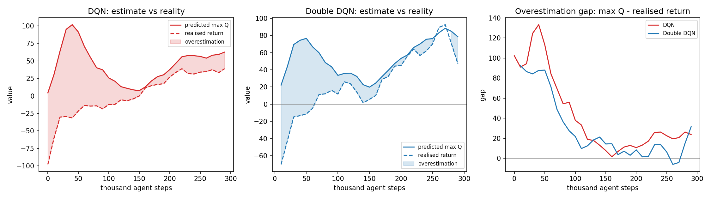
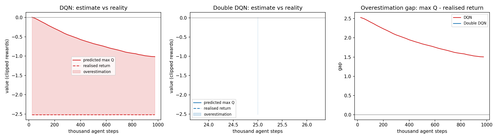
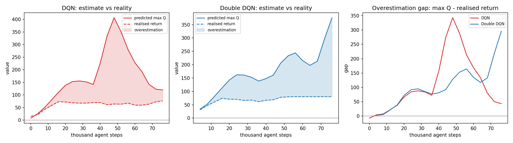
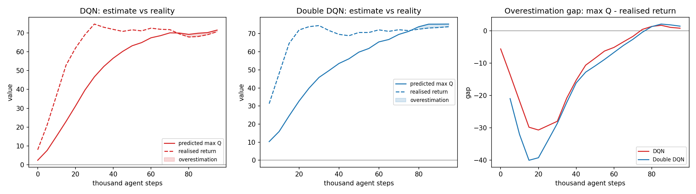

# DQN overestimation and the Double DQN fix (measured results)

Results produced with the NeatRL implementations in this repo:

| module | trainer |
|---|---|
| `src/neatrl/dqn_mlp.py` | `train_dqn` (vector observations) |
| `src/neatrl/dqn_cnn.py` | `train_dqn_cnn` (Atari frames) |
| `src/neatrl/double_dqn_mlp.py` | `train_double_dqn` |
| `src/neatrl/double_dqn_cnn.py` | `train_double_dqn_cnn` |

The two Double DQN modules are drop-in replacements for the plain DQN ones and
differ *only* in the bootstrap target:

```
DQN        : Y = r + gamma * max_a Q_target(s', a)
Double DQN : Y = r + gamma * Q_target(s', argmax_a Q_online(s', a))
```

Everything below comes from `docs/non-cli/DQN/overestimation_demo.py`.

---

## 1. How the bias is measured

Following Figure 3 of van Hasselt, Guez & Silver (2016), run *greedy*
evaluation episodes and, for every state the policy actually visits, record two
numbers:

| quantity | definition |
|---|---|
| predicted | `max_a Q(s_t, a)` |
| realised | `G_t = sum_{k >= t} gamma^(k-t) r_k` |

Both are averaged over the *same* states, so an unbiased critic makes the two
curves coincide. Overestimation appears as the predicted curve riding above the
realised one.

> Note: an earlier version of this measurement averaged `max Q` over all states
> but compared it against a single per-episode `G_0`. Those are different
> quantities and the gap then just tracks how far `Q` is from the value of a
> random policy — it does not isolate the bias. The results below use the
> corrected per-state pairing.

### Where the bias comes from

`E[max_a Q_hat(s', a)] >= max_a E[Q_hat(s', a)]` because `max` is convex. Noise
in `Q_target` is passed through a `max`, so the target is biased upward, and the
agent then bootstraps from its own inflated values, compounding the error.
Double DQN uses the online network to *select* the action and the target network
to *score* it, so the noise is no longer maximised over the same estimate.

---

## 2. Headline result: LunarLander-v3

Command (demo defaults except the step budget — no tuning, single seed):

```bash
python docs/non-cli/DQN/overestimation_demo.py \
    --env-id LunarLander-v3 --steps 300000 --eval-every 10000
```

Environment: 8-dim continuous observation, `Discrete(4)` actions.
Both agents learned (episode return went from -221 to about +230), which is the
precondition for the measurement to mean anything.



| algorithm | gap overall | gap last half | peak gap |
|---|---|---|---|
| DQN | **+42.9** | **+16.0** | **+139.3** |
| Double DQN | +28.6 | +8.1 | +98.9 |
| difference | +14.4 | +7.9 | +40.3 |

### The three phases, in order

**Phase 1 — learning (0-80k steps). The gap explodes.**

| step | predicted | realised | gap | episode return |
|---|---|---|---|---|
| 10k | +12.8 | -35.6 | +48.4 | -221.1 |
| 20k | +78.2 | -17.1 | +95.3 | -176.7 |
| 30k | +101.2 | -38.1 | +139.3 | -154.5 |
| 40k | +105.8 | -33.3 | +139.1 | -240.1 |

The network claims a state is worth +105 while the greedy policy is actually
*losing* 33 per episode. This is the mechanism at its clearest: Q-values are
large and noisy, `max` over 4 actions picks the noisiest one, and the target
bootstraps from it.

**Phase 2 — convergence (90-160k). The gap collapses.** As predictions get
accurate, both algorithms fall back toward zero. DQN briefly goes *negative*
(-2.0 at 160k): the bias is an average tendency, not a guarantee at every step.

**Phase 3 — steady state (170-300k).**

| step | DQN predicted | DQN realised | Double predicted | Double realised |
|---|---|---|---|---|
| 210k | +53.3 | +38.9 | +57.7 | +57.0 |
| 250k | +52.9 | +33.4 | +76.2 | +83.1 |
| 270k | +51.0 | +19.5 | +90.5 | +92.5 |
| 290k | +61.1 | +37.2 | +71.7 | +24.1 |

DQN settles roughly +20 above reality. Double DQN ends up tracking reality and
sometimes slightly *below* it (pessimistic). That is the honest punchline:
Double DQN removes the systematic **upward** push from the `max`; it does not
make the estimate perfect, and overshooting into conservatism is a different
error.

---

## 3. Why the Atari run was inconclusive

Command:

```bash
python docs/non-cli/DQN/overestimation_demo.py \
    --env-id ALE/Pong-v5 --steps 1000000 --eval-every 25000
```

Result: **all 40 evaluations returned -21.0** — random play for the entire run.

| step | predicted | realised | episode return |
|---|---|---|---|
| 25k | +0.02 | -2.52 | -21.0 |
| 500k | -0.68 | -2.52 | -21.0 |
| 975k | -1.01 | -2.52 | -21.0 |

1M agent steps is 4M frames, only ~8% of the paper's 50M. The predicted curve
was simply walking down toward the true value of a random policy. This is
under-fitting, not overestimation, so the run says nothing about the bias.

**Takeaway:** the effect is only measurable once the agent actually learns. On
Pong that needs the paper's budget (12.5M agent steps, many hours); on
LunarLander it needs a few hundred thousand.



---

## 4. CartPole-v1: the same effect, both regimes

**Unstable regime** (`--steps 80000`, defaults): Q blows up for *both*
algorithms, so the bias is huge but the contrast is muddy.



| algorithm | gap overall | last half | peak |
|---|---|---|---|
| DQN | +110.5 | +174.4 | +429.0 |
| Double DQN | +105.7 | +151.9 | +349.9 |

DQN's network claims +474 while the policy collects about +70.

**Stable regime** (`--lr 1e-4 --target-network-frequency 500`): both curves
track reality, and neither shows a large gap.



| algorithm | gap overall | last half | peak |
|---|---|---|---|
| DQN | -11.2 | -1.8 | +2.8 |
| Double DQN | -14.4 | -2.7 | +2.5 |

This is worth internalising: the bias is a property of the `max` in the target,
so it only becomes visible when Q-values are large and noisy. In a well-behaved
run both estimates converge onto the realised return and the difference is small.

---

## 5. Environment choice matters

| environment | obs | actions | learns in | usable for this study? |
|---|---|---|---|---|
| `CartPole-v1` | continuous (4) | `Discrete(2)` | < 20k steps | yes, but only 2 actions so the `max` bias is small |
| `LunarLander-v3` | continuous (8) | `Discrete(4)` | ~100k steps | **yes — clearest signal** |
| `ALE/Pong-v5` | image (4x84x84) | `Discrete(6)` | ~12.5M steps (paper) | only with a multi-hour budget |
| `FrozenLake-v1` | discrete (16) | `Discrete(4)` | ~20k steps | yes, with `--grid-env` (one-hot encoding) |
| `CliffWalking-v1` | discrete (48) | `Discrete(4)` | ~20k steps | yes, with `--grid-env` |
| `Taxi-v4` | discrete (500) | `Discrete(6)` | slower | yes, with `--grid-env` |

More actions means a larger `max` over noise, so the bias is easier to see;
`LunarLander` (4 actions) hits the sweet spot where the agent still learns fast.

---

## 6. Reproducing

```bash
# headline result
python docs/non-cli/DQN/overestimation_demo.py --env-id LunarLander-v3 \
    --steps 300000 --eval-every 10000

# DQN only (watch the bias appear, then vanish as Q converges)
python docs/non-cli/DQN/overestimation_demo.py --env-id LunarLander-v3 \
    --steps 300000 --algorithms dqn

# quick smoke run
python docs/non-cli/DQN/overestimation_demo.py --steps 5000
```

The script prints one line per evaluation, writes
`runs/overestimation/overestimation_<env>_<steps>steps.csv`, and rewrites the
matching `.png` after every evaluation so the plot can be watched live. The
figure has three panels: DQN estimate vs reality, Double DQN estimate vs
reality, and both gaps on one axis.

Add `--seeds 3` for error bars over seeds.
